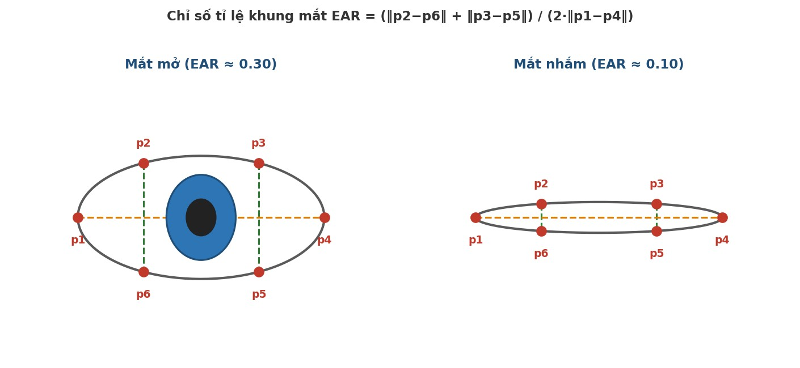

# Hệ thống Giám sát người lái (DMS) trên ROS2 với cảnh báo qua CAN bus

Đồ án môn học – Ngành Kỹ sư Ô tô số, Đại học Bách khoa Hà Nội (HUST), 2026.

Phần mềm giám sát người lái dùng camera trong cabin để phát hiện **buồn ngủ** (nhắm mắt kéo dài) và **mất tập trung** (quay đầu đi chỗ khác, rời khỏi khung hình). Hệ thống được tổ chức thành các node ROS2 độc lập; khi phát hiện nguy cơ, trạng thái cảnh báo được gửi ra **CAN bus qua SocketCAN** tới một vi điều khiển (Arduino) để kích hoạt cảnh báo phần cứng, đồng thời hiển thị trên giao diện web.

## Video demo

[](https://www.youtube.com/watch?v=4RZDJwtkaXk)

## Tính năng

- **Phát hiện nhắm mắt** bằng chỉ số EAR (Eye Aspect Ratio) tính từ 6 điểm mốc quanh mắt của MediaPipe Face Mesh. Mắt mở EAR khoảng 0,3; mắt nhắm EAR giảm xuống dưới ngưỡng 0,2.
- **Phát hiện mất tập trung** bằng ước lượng tư thế đầu (góc yaw/pitch) và phát hiện người lái rời khỏi khung hình.
- **Hiệu chuẩn tư thế đầu** theo từng người lái trong 5 giây đầu (lấy góc nhìn thẳng làm gốc).
- **Bộ quản lý cảnh báo có độ trễ kích hoạt/xóa** (ví dụ nhắm mắt > 2 s, mất tập trung > 3 s) để tránh báo động giả khi chớp mắt hay liếc nhanh.
- **Giao tiếp CAN** qua SocketCAN: gửi trạng thái người lái, heartbeat và nhận phản hồi từ phần cứng, có bộ đếm vòng (rolling counter) và giám sát timeout.
- **Giao diện web** xem luồng video có vẽ điểm mốc và các chỉ số theo thời gian thực.
- **Unit test** cho phần logic lõi và cấu hình (pytest).

<p align="center"></p>

## Kiến trúc hệ thống

```
camera_node ──(sensor_msgs/Image)──► driver_monitor_node ──(DriverMetrics)──► warning_manager_node
                                            │                                        │
                                            │ ảnh đã vẽ điểm mốc               (WarningState)
                                            ▼                                        ▼
                                     web_stream_node  ◄──────────────────  socketcan_bridge_node
                                     (HTTP :8080)                                │  ▲
                                                                       0x180/0x181  0x280
                                                                                 ▼  │
                                                                              Arduino (CAN)
```

| Node | Chức năng |
|---|---|
| `camera_node` | Đọc camera (V4L2), cấu hình độ phân giải, phơi sáng, gain |
| `driver_monitor_node` | MediaPipe Face Mesh → EAR, yaw/pitch, phát `DriverMetrics` |
| `warning_manager_node` | Máy trạng thái cảnh báo: `NORMAL`, `EYES_CLOSED`, `DISTRACTED`, `OUT_OF_FRAME`, `SYSTEM_FAULT` |
| `socketcan_bridge_node` | Cầu nối ROS2 ↔ CAN bus |
| `web_stream_node` | Máy chủ web hiển thị video MJPEG và trạng thái |

## Giao thức CAN

| CAN ID | Hướng | Nội dung (8 byte) | Chu kỳ |
|---|---|---|---|
| `0x180` | DMS → Arduino | byte 0: trạng thái cảnh báo, byte 1: rolling counter | 10 Hz |
| `0x181` | DMS → Arduino | byte 0: phiên bản giao thức, byte 1: tình trạng hệ thống, byte 2: counter | 1 Hz |
| `0x280` | Arduino → DMS | byte 0: phần cứng OK (0/1), byte 1: counter, byte 2–7 = 0 | timeout 3 s |

## Cấu trúc thư mục

```
src/
├── driver_monitor_interfaces/     # message tùy chỉnh: DriverMetrics, WarningState
└── driver_monitor/
    ├── driver_monitor/            # mã nguồn các node + core.py (logic EAR, cảnh báo, đóng gói CAN)
    ├── config/                    # tham số YAML (ngưỡng EAR, thời gian kích hoạt, CAN ID...)
    ├── launch/                    # launch file khởi động toàn bộ hệ thống
    ├── static/                    # giao diện web (HTML/CSS/JS)
    └── test/                      # unit test
```

## Công nghệ sử dụng

ROS2 · Python 3.10 · MediaPipe Face Mesh · OpenCV · SocketCAN (socket raw của Linux) · pytest · HTML/CSS/JavaScript

## Cách chạy

```bash
# Build workspace
cd ros2_ws
colcon build
source install/setup.bash

# Bật giao tiếp CAN (ví dụ 500 kbit/s)
sudo ip link set can0 up type can bitrate 500000

# Chạy toàn bộ hệ thống
ros2 launch driver_monitor driver_monitor.launch.py

# Chạy không có CAN hoặc không có web
ros2 launch driver_monitor driver_monitor.launch.py enable_can:=false enable_web:=false
```

Giao diện web: `http://<địa_chỉ_IP>:8080`

Chạy unit test:
```bash
colcon test --packages-select driver_monitor
```

## Tác giả

Vũ Thành Đức – [github.com/milkywayvtd](https://github.com/milkywayvtd)
Dự án được thực hiện cùng nhóm trong khuôn khổ đồ án môn học.
